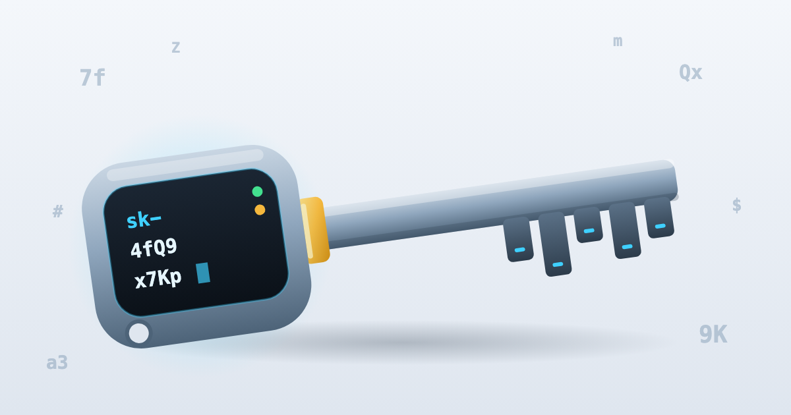
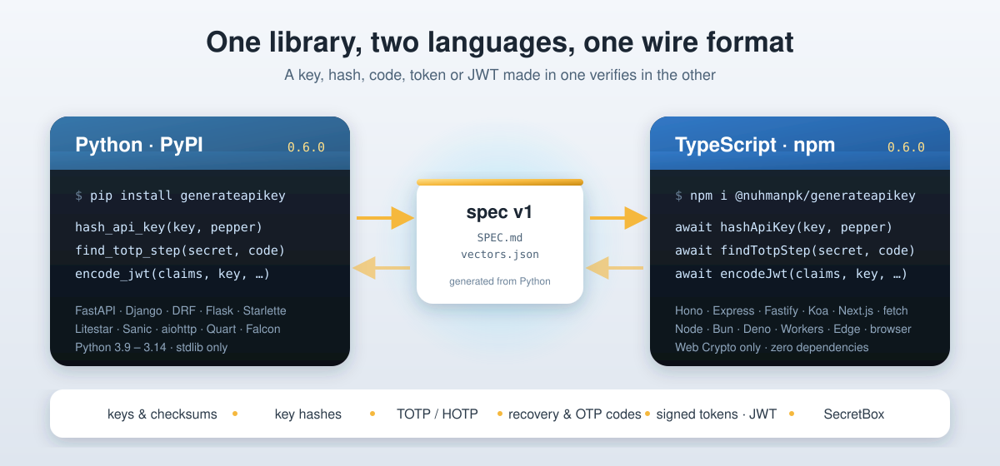

<p align="center">

</p>

<h1 align="center">generateapikey</h1>

<p align="center">
<b>Secure API keys and MFA with zero dependencies, for Python and JavaScript.</b><br>
Keys, hashing, scopes, rotation, framework auth, TOTP/HOTP, recovery codes, OTPs, magic links, JWT and encryption at rest,<br>
on the same wire format in both languages.
</p>

<p align="center">
<a href="https://pypi.org/project/generateapikey/"></a>
<a href="https://www.npmjs.com/package/@nuhmanpk/generateapikey"></a>
<a href="https://github.com/nuhmanpk/generate-api-key/actions/workflows/python.yml"></a>
<a href="https://github.com/nuhmanpk/generate-api-key/actions/workflows/js.yml"></a>
<a href="https://github.com/nuhmanpk/generate-api-key/actions/workflows/interop.yml"></a>

<a href="https://github.com/nuhmanpk/generate-api-key/blob/main/LICENSE"></a>
</p>

<p align="center">

</p>

## Pick your language

| | **Python** | **JavaScript / TypeScript** |
|---|---|---|
| Package name | `generateapikey` | `@nuhmanpk/generateapikey` (npm requires the scope) |
| Install | `pip install generateapikey` | `npm i @nuhmanpk/generateapikey` |
| Docs | [python/README.md](https://github.com/nuhmanpk/generate-api-key/blob/main/python/README.md) · [API reference](https://github.com/nuhmanpk/generate-api-key/blob/main/docs/python.md) | [js/README.md](https://github.com/nuhmanpk/generate-api-key/blob/main/js/README.md) · [API reference](https://github.com/nuhmanpk/generate-api-key/blob/main/docs/js.md) |
| Registry | [pypi.org/project/generateapikey](https://pypi.org/project/generateapikey/) | [npmjs.com/package/@nuhmanpk/generateapikey](https://www.npmjs.com/package/@nuhmanpk/generateapikey) |
| Version | 0.6.0 | 0.6.0 (always the same number) |

```python
# Python
from generateapikey import generate_api_key, hash_api_key, verify_api_key

key = generate_api_key(prefix="sk", checksum=True)
stored = hash_api_key(key, PEPPER)
verify_api_key(key, stored, PEPPER)            # True
```

```ts
// TypeScript
import { generateApiKey, hashApiKey, verifyApiKey } from "@nuhmanpk/generateapikey";

const key = generateApiKey({ prefix: "sk", checksum: true });
const stored = await hashApiKey(key, PEPPER);
await verifyApiKey(key, stored, PEPPER);       // true, and true for the Python hash too
```

## npm vs PyPI

Both packages have the same features and produce the same bytes. They differ only where the
languages do.

| | PyPI (`python/`) | npm (`js/`) |
|---|---|---|
| **Runtime** | Python 3.9 – 3.14 | Node.js 20+, Bun, Deno, Cloudflare Workers, Vercel Edge, browsers |
| **Crypto backend** | standard library (`secrets`, `hashlib`, `hmac`) | Web Crypto (`globalThis.crypto`) |
| **Runtime dependencies** | none (`cryptography` only for the optional `crypto` extra) | none |
| **Style** | `snake_case`, mostly synchronous | `camelCase`; hashing and signing are `async` (Web Crypto) |
| **Module format** | wheel + sdist, typed (`py.typed`) | ESM + CJS, `.d.ts` types, `sideEffects: false` |
| **API keys** (random, derived, prefix, checksum, expiry, 11 charsets) | ✅ | ✅ byte-identical |
| **Hashing** (SHA-256 / HMAC + pepper, PBKDF2 for codes) | ✅ | ✅ byte-identical |
| **Scopes, rotation, key store** | ✅ `KeyStore` on SQLite | ✅ `KeyStore` on any SQL driver (D1, SQLite, libSQL…) or in memory, same table |
| **Framework auth** | FastAPI, Starlette, Django, DRF, Flask, Litestar, Sanic, aiohttp, Quart, Falcon | Hono, Express, Fastify, Koa, Next.js, any fetch handler |
| **TOTP / HOTP / Steam, otpauth and migration URIs** | ✅ | ✅ byte-identical |
| **Recovery codes, email/SMS codes** | ✅ | ✅ byte-identical hashes |
| **Attempt limiter** | in memory + Redis | in memory + Redis (shares Python's counters) |
| **Signed tokens (magic links)** | ✅ | ✅ byte-identical |
| **JWT** HS / RS / PS / ES / EdDSA, JWKS | ✅ (asymmetric needs the `crypto` extra) | ✅ built in |
| **SecretBox** (AES-256-GCM) | ✅ (`crypto` extra) | ✅ built in |
| **QR codes** | `qrcode` extra | built in (`@nuhmanpk/generateapikey/qr`), output identical to Python's |
| **Leak detection** (scanner regexes, gitleaks) | ✅ | ✅ same regex text |
| **CLI** | `generate-api-key` | `npx @nuhmanpk/generateapikey` (same commands) |
| **Tests** | 340 | 325 vitest, plus 1,444 runtime checks on Node 20, Bun, Deno and Workers |
| **Key generation speed** | ~606 k keys/s | ~1.1 M keys/s (Node 24), ~1.9 M (Bun) |

Use whichever matches your stack, or both. A Python backend and a TypeScript edge worker can share
one key table, one pepper, one TOTP secret store and one Redis rate limit.

## How the two stay compatible

- **[spec/SPEC.md](https://github.com/nuhmanpk/generate-api-key/blob/main/spec/SPEC.md)** documents every format and algorithm: key layout, rejection
  sampling, derivation, checksums, hash formats, PBKDF2, TOTP, URIs, tokens, JWT, SecretBox and auth
  behaviour. It's versioned (currently v1). Python is the source of truth.
- **[spec/vectors.json](https://github.com/nuhmanpk/generate-api-key/blob/main/spec/vectors.json)** is generated from the Python implementation, with clock and
  randomness pinned. Both test suites replay it, and CI fails if regenerating it changes the file.
- **Live interop.** On every change, CI has each package make fresh keys, hashes, codes, tokens,
  JWTs (with freshly generated RSA, EC and Ed25519 keys) and ciphertexts, and the other package
  verify them.

## Security

The design depends only on secret values (OS randomness and your server secrets), never on the
code being hidden, so the code can be fully open. [SECURITY.md](https://github.com/nuhmanpk/generate-api-key/blob/main/SECURITY.md)
walks through each attack: predicting keys, brute force, a stolen database, timing, replay,
token forgery, algorithm confusion and supply chain. For each one it explains why it fails, and it
also covers what the library can't protect you from.

## Repository layout

```
python/        PyPI package: generateapikey/, tests/, scripts/ (vector generator, interop), examples/, benchmarks/
js/            npm package: src/ (core + integrations/), test/, bench/
spec/          SPEC.md and vectors.json (shared by both test suites)
docs/          full API references: python.md, js.md
assets/        images for the READMEs
.github/       CI: python.yml, js.yml, interop.yml; releases: py-release.yml (tag py-v*), js-release.yml (tag js-v*)
```

## Development

```bash
# Python
cd python && pip install -e ".[dev]"
pytest -q && ruff check . && mypy
python scripts/gen_vectors.py          # regenerate spec/vectors.json after a format change

# JavaScript
cd js && npm ci
npm run typecheck && npm test && npm run build && npm run test:smoke
```

See [AGENTS.md](https://github.com/nuhmanpk/generate-api-key/blob/main/AGENTS.md) for the
cross-language rules and [CONTRIBUTING.md](https://github.com/nuhmanpk/generate-api-key/blob/main/CONTRIBUTING.md)
for how to contribute.

## License

[MIT](https://github.com/nuhmanpk/generate-api-key/blob/main/LICENSE) © Nuhman Pk
