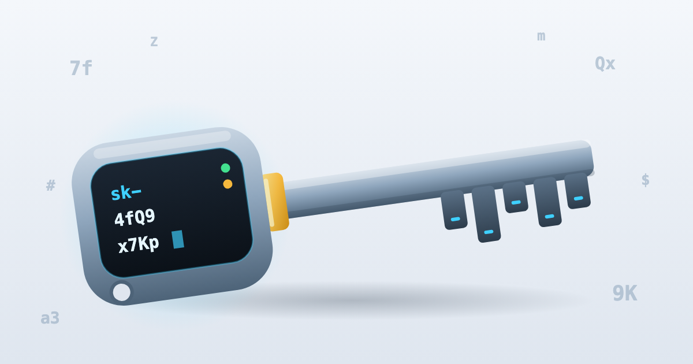

<p align="center">

</p>

# generateapikey

**Secure API keys and MFA for JavaScript and TypeScript, with zero dependencies.**

It runs on Web Crypto only, so the same code works on Node.js 20+, Bun, Deno, Cloudflare Workers,
Vercel Edge and in browsers. It is **wire-compatible with the Python package**: a key, hash, code,
token or JWT made in one language verifies in the other.

[](https://www.npmjs.com/package/@nuhmanpk/generateapikey)
[](https://pypi.org/project/generateapikey/)
[](https://github.com/nuhmanpk/generate-api-key/actions/workflows/js.yml)
[](https://github.com/nuhmanpk/generate-api-key/actions/workflows/interop.yml)


[](https://github.com/nuhmanpk/generate-api-key/blob/main/LICENSE)

```bash
npm i @nuhmanpk/generateapikey      # or: pnpm add / yarn add / bun add @nuhmanpk/generateapikey
deno add npm:@nuhmanpk/generateapikey
```

On npm the package is scoped (`@nuhmanpk/generateapikey`) because npm reserves names that look like
existing packages. On PyPI it is `generateapikey`. Both are the same library at the same version.

## What's inside

| | |
|---|---|
| **API keys** | random or derived keys, prefixes, checksums, expiry, 11 charsets, entropy checks |
| **Storage** | SHA-256 / HMAC-SHA256 hashing with a pepper, constant-time verification |
| **Access control** | scopes with wildcards (`read:*`, `*`), key rotation with a grace period, a key store |
| **Framework auth** | `APIKeyAuth` plus adapters for **Hono, Express, Fastify, Koa, Next.js** and any fetch handler |
| **MFA** | TOTP / HOTP (RFC 6238 / 4226), recovery codes, email/SMS codes, Steam Guard, otpauth and Google Authenticator migration URIs, QR codes |
| **Tokens** | signed magic links bound to a purpose and session; JWT with HS, RS, PS, ES and EdDSA, plus JWKS |
| **Secrets at rest** | `SecretBox`: AES-256-GCM with key rotation |
| **Abuse protection** | an attempt limiter, in memory or Redis (shares counters with Python) |
| **Leak detection** | regexes for secret scanners, `findKeys`, gitleaks rules |
| **CLI** | `npx @nuhmanpk/generateapikey` |

## Quick start

```ts
import { generateApiKey, hashApiKey, verifyApiKey } from "@nuhmanpk/generateapikey";

const key = generateApiKey({ prefix: "sk", checksum: true }); // "sk-Xr4…q9Tz2bKf1A"
const stored = await hashApiKey(key, process.env.PEPPER);    // store this, never the key

await verifyApiKey(key, stored, process.env.PEPPER);         // true (constant-time)
```

Key generation is synchronous. Anything that hashes, signs or verifies is `async`, because Web
Crypto is. Expiry options are in **minutes**, and every timestamp is in **unix seconds**, the same
as in Python.

## Runtimes

| Runtime | Status | Checked in CI by |
|---|---|---|
| Node.js 22, 24 | ✅ | vitest: 325 tests |
| Node.js 20 | ✅ | smoke run of the built package: 361 checks |
| Bun | ✅ | smoke run: 361 checks |
| Deno | ✅ | smoke run: 361 checks |
| Cloudflare Workers (workerd) | ✅ | smoke run in Miniflare: 361 checks |
| Vercel Edge Runtime | ✅ | vitest `edge-runtime` environment |
| Browsers | ✅ | uses only `globalThis.crypto`, `TextEncoder` and `Uint8Array` |

The core imports no Node built-ins: no `crypto` module, no `Buffer`. Cloudflare Workers limits
PBKDF2 to 100,000 iterations, which is this library's default, so code hashes work there unchanged.

## Protect your API

```ts
import { APIKeyAuth, issueApiKey } from "@nuhmanpk/generateapikey";

// When a user creates a key:
const { key, hashed, hint } = await issueApiKey({ prefix: "sk", pepper: env.PEPPER });
await db.insert({ hashed, hint, userId, scopes: ["read:*"] }); // show `key` to the user once

// On every request:
const auth = new APIKeyAuth({
  lookup: (hashed) => db.findByHash(hashed), // gets the hash, never the raw key
  pepper: env.PEPPER,
  prefix: "sk",
  requireChecksum: true, // rejects typos before touching the database
});
```

Then use the adapter for your framework. Each one answers `401` (with `WWW-Authenticate`), `403`
or `429` with `{"detail": "..."}`, the same as the Python integrations.

<details open><summary><b>Hono</b> (Workers, Bun, Deno, Node)</summary>

```ts
import { apiKey } from "@nuhmanpk/generateapikey/hono";
app.use("/api/*", apiKey(auth, { exclude: ["/api/health"] }));
app.get("/api/admin", apiKey(auth, { scopes: ["admin"] }), (c) => c.json(c.get("apiKey")));
```
</details>

<details><summary><b>Express</b></summary>

```ts
import { apiKey } from "@nuhmanpk/generateapikey/express";
app.use("/api", apiKey(auth));                      // req.apiKey = the stored record
app.get("/admin", apiKey(auth, { scopes: ["admin"] }), handler);
```
</details>

<details><summary><b>Fastify</b></summary>

```ts
import { apiKeyPlugin, apiKey } from "@nuhmanpk/generateapikey/fastify";
await app.register(apiKeyPlugin, { auth });         // every route; request.apiKey
app.get("/admin", { preHandler: apiKey(auth, { scopes: ["admin"] }) }, handler);
```
</details>

<details><summary><b>Koa</b></summary>

```ts
import { apiKey } from "@nuhmanpk/generateapikey/koa";
app.use(apiKey(auth));                              // ctx.state.apiKey
```
</details>

<details><summary><b>Next.js</b> (middleware and route handlers)</summary>

```ts
// middleware.ts
import { apiKeyMiddleware } from "@nuhmanpk/generateapikey/next";
export const middleware = apiKeyMiddleware(auth, { exclude: ["/api/health"] });
export const config = { matcher: "/api/:path*" };

// app/api/items/route.ts
import { withApiKey } from "@nuhmanpk/generateapikey/next";
export const GET = withApiKey(auth, async (req, record) => Response.json({ owner: record.id }));
```
</details>

<details><summary><b>Any fetch handler</b> (Cloudflare Workers, Deno.serve, Bun.serve, SvelteKit, Remix, Astro…)</summary>

```ts
import { withApiKey } from "@nuhmanpk/generateapikey/web";
export default { fetch: withApiKey(auth, async (req, record) => Response.json({ hello: record.id })) };
```
</details>

### Scopes, rotation and a ready-made key store

```ts
import { KeyStore, SqlKeyStorage, APIKeyAuth } from "@nuhmanpk/generateapikey";

// Cloudflare D1 (better-sqlite3, node:sqlite and libSQL work the same way)
const store = new KeyStore(new SqlKeyStorage({
  all: async (sql, p) => (await env.DB.prepare(sql).bind(...p).all()).results,
  run: async (sql, p) => ({ lastInsertRowid: (await env.DB.prepare(sql).bind(...p).run()).meta.last_row_id }),
}), { pepper: env.PEPPER });

const { key, id } = await store.create("ci-bot", { prefix: "sk", scopes: ["read:*"], expiry: 60 * 24 * 90 });
const auth = new APIKeyAuth({ lookup: store.lookup, pepper: env.PEPPER, requiredScopes: ["read:users"] });
const next = await store.rotate(id, { prefix: "sk", graceMinutes: 24 * 60 }); // the old key works for 24 h more
await store.revoke(next.id);
```

The table uses the same schema as the Python `KeyStore`, so a Python service and a JS service can
share one `api_keys` table.

## MFA

```ts
import { generateTotpSecret, totpUri, findTotpStep, AttemptLimiter, SecretBox } from "@nuhmanpk/generateapikey";
import { qrSvg } from "@nuhmanpk/generateapikey/qr";

// Setup
const secret = generateTotpSecret();
const svg = qrSvg(totpUri(secret, "alice@example.com", "MyApp"));         // show it to the user
const box = await SecretBox.create(env.ENCRYPTION_KEY);
await db.saveTotp(user.id, await box.encrypt(secret, String(user.id))); // encrypted at rest

// Login
const limiter = new AttemptLimiter({ maxAttempts: 5, window: 15 * 60 });
if (!limiter.hit(user.id)) throw new Error("Too many attempts");
const step = await findTotpStep(await box.decrypt(row.totp, String(user.id)), code, { lastUsedStep: row.lastStep });
if (step !== null) await db.setLastStep(user.id, step);                  // stops replay of the same code
```

Recovery codes (`generateRecoveryCodes`, `hashRecoveryCode`, `verifyRecoveryCode`), email/SMS codes
(`generateOtp`, `hashOtp`, `verifyOtp`), Steam Guard codes and Google Authenticator migration URIs are
included too. See the [full reference](https://github.com/nuhmanpk/generate-api-key/blob/main/docs/js.md).

## Magic links and JWT

```ts
import { generateSignedToken, verifySignedToken, encodeJwt, decodeJwt, decodeJwtJwks } from "@nuhmanpk/generateapikey";

const link = await generateSignedToken(env.SECRET, { uid: 42 }, { purpose: "login", expiry: 15, context: sessionId });
await verifySignedToken(link, env.SECRET, { purpose: "login", context: sessionId });  // { uid: 42 } or null

const jwt = await encodeJwt({ sub: "42" }, env.JWT_SECRET, { issuer: "me", audience: "api" });
await decodeJwt(jwt, env.JWT_SECRET, { algorithms: ["HS256"], issuer: "me", audience: "api" });

// RS/PS/ES/EdDSA take a PEM (PKCS#8, SPKI, PKCS#1, SEC1), a JWK or a CryptoKey
await decodeJwtJwks(token, await (await fetch(JWKS_URL)).json(), { algorithms: ["RS256"] });
```

## Cross-language compatibility

Both packages implement [spec v1](https://github.com/nuhmanpk/generate-api-key/blob/main/spec/SPEC.md).
The JS tests replay [`spec/vectors.json`](https://github.com/nuhmanpk/generate-api-key/blob/main/spec/vectors.json),
which is generated from the Python implementation. On every change, CI also has each language make
fresh values and the other verify them.

```python
# Python service
from generateapikey import hash_api_key
stored = hash_api_key(key, PEPPER)          # "hmac-sha256$…"
```

```ts
// JS service, same database
await verifyApiKey(key, stored, PEPPER);     // true
```

| Value | Compatible |
|---|---|
| Key format, checksums, derived keys (secret + seed) | byte-identical |
| `hashApiKey`, PBKDF2 code hashes, recovery-code and OTP hashes | byte-identical |
| TOTP / HOTP / Steam codes, otpauth and migration URIs | byte-identical |
| Signed tokens, HS JWTs, SecretBox ciphertexts (given the same random bytes) | byte-identical |
| RS / PS / ES / EdDSA JWTs | verify across languages |
| Redis limiter keys and script | shared counters |

The two APIs follow each language's conventions (`hash_api_key` in Python, `hashApiKey` in JS), but the
concepts and defaults are the same. There's a full [Python → JS name table](https://github.com/nuhmanpk/generate-api-key/blob/main/docs/js.md).

## Tests

| Suite | Tests | What it covers |
|---|---:|---|
| Cross-language vectors (Node + Edge) | 54 groups, thousands of cases | every format against Python's output |
| Unit tests | 30 | randomness (chi-square bias tests), limits, errors, key store |
| JWT with fresh keys | 14 | 10 algorithms × every key format, algorithm confusion, small-key rejection |
| Framework adapters | 7 | real Hono, Express, Fastify, Koa and Next.js apps against one shared contract |
| QR encoder | 61 | matrices identical to Python's `qrcode` |
| Runtime smoke (Node 20, Bun, Deno, Workers) | 361 × 4 | the built package on each runtime |
| Live interop (JS ⇄ Python) | 17 × 2 | fresh values made in one language, verified in the other |

That's **325 vitest tests** (run on both Node and Vercel Edge), plus **1,444 smoke checks** across four
runtimes and **34 interop checks**. The Python package has 340 tests of its own.

## Performance

Apple M-series, Node 24 (`node bench/bench.mjs`; Python numbers from `python benchmarks/bench.py`
on the same machine):

| Operation | JS (Node 24) | JS (Bun) | Python 3.11 |
|---|---:|---:|---:|
| `generateApiKey()` | **1.1 M ops/s** | **1.9 M ops/s** | 606 k ops/s |
| `generateApiKey({ prefix, checksum })` | 742 k ops/s | 1.35 M ops/s | 405 k ops/s |
| `verifyApiKey` (HMAC) | 99 k ops/s | 112 k ops/s | 320 k ops/s |
| `verifyTotp` (window 1) | 37 k ops/s | 75 k ops/s | 78 k ops/s |
| `hashOtp` (PBKDF2, 100k iterations, slow on purpose) | 106 ops/s | 152 ops/s | 101 ops/s |

Key generation is about twice as fast as the Python package: random bytes come in batches, and
rejection sampling uses a lookup table. Hashing and signing go through Web Crypto, which is native
code but asynchronous, so each call costs a few microseconds of scheduling. That still leaves about
100,000 key checks per second per core.

## Security

All randomness comes from `crypto.getRandomValues`, with no modulo bias. Every secret comparison is
constant-time. Only hashes are stored, short codes use salted PBKDF2, and algorithms are pinned for
JWT. [SECURITY.md](https://github.com/nuhmanpk/generate-api-key/blob/main/SECURITY.md) goes through
each attack (prediction, brute force, a stolen database, timing, replay, algorithm confusion…) and
explains why it fails, along with what the library can't protect you from.

## CLI

```bash
npx @nuhmanpk/generateapikey -n 3 --prefix sk --checksum --hash
npx @nuhmanpk/generateapikey totp -a alice@example.com -i MyApp --qr
npx @nuhmanpk/generateapikey recovery --hash
npx @nuhmanpk/generateapikey --llms          # usage guide for AI coding agents
```

These are the same commands and flags as the Python CLI. Secrets can also be passed through
environment variables (`GENERATEAPIKEY_SECRET`, `GENERATEAPIKEY_PEPPER`, `GENERATEAPIKEY_TOTP_SECRET`)
or `-` for stdin.

## Documentation

- [Full JS API reference](https://github.com/nuhmanpk/generate-api-key/blob/main/docs/js.md): every export, low-level building blocks, units, errors
- [Wire-format spec](https://github.com/nuhmanpk/generate-api-key/blob/main/spec/SPEC.md)
- [Security model](https://github.com/nuhmanpk/generate-api-key/blob/main/SECURITY.md)
- [Guide for AI coding agents](https://github.com/nuhmanpk/generate-api-key/blob/main/js/llms.txt) (also `npx @nuhmanpk/generateapikey --llms`)
- [Python package](https://github.com/nuhmanpk/generate-api-key/blob/main/python/README.md) · [Changelog](https://github.com/nuhmanpk/generate-api-key/blob/main/js/CHANGELOG.md)

## License

[MIT](https://github.com/nuhmanpk/generate-api-key/blob/main/LICENSE)
