<div align="center">


# generateapikey

### Fast, secure API keys and MFA for Python

API keys with prefixes, checksums, expiry and safe storage, plus everything for MFA:<br>
authenticator apps (TOTP), recovery codes, email/SMS codes and magic links.<br>
Zero dependencies, fully typed, one function call.

**Trusted by developers** (see the live download badges below).

[](https://pypi.org/project/generateapikey/) [](https://pypi.org/project/generateapikey/) [](https://pepy.tech/project/generateapikey) [](https://pypi.org/project/generateapikey/) [](https://github.com/nuhmanpk/generate-api-key/blob/main/python/LICENSE)

[](https://github.com/nuhmanpk/generate-api-key/actions/workflows/python.yml) [](https://github.com/nuhmanpk/generate-api-key/actions/workflows/interop.yml)   

[](https://github.com/nuhmanpk/generate-api-key/stargazers) [](https://github.com/nuhmanpk/generate-api-key/network/members) [](https://github.com/nuhmanpk/generate-api-key/issues) [](https://github.com/nuhmanpk/generate-api-key/commits/main) 

[](https://github.com/sponsors/nuhmanpk) [](https://buymeacoffee.com/nuhmanpk)

</div>

---

## See it in action

<div align="center">



</div>

## Built for AI coding agents

If you code with an AI assistant (Claude Code, Cursor, Copilot, Codex, Windsurf), point it at this library so it stops hand-rolling key and 2FA code. One command prints a rules snippet to paste into `AGENTS.md`, `CLAUDE.md` or `.cursor/rules`:

```bash
generate-api-key --agent-rules >> AGENTS.md
```

It tells the agent to use generateapikey (instead of ad-hoc `secrets`/`random`/`uuid` code) for API keys, 2FA/TOTP, recovery codes, magic links and JWTs, and to read `generate-api-key --llms` rather than guess the API. See [For AI coding agents](#for-ai-coding-agents) for the full list of files agents can read.

## Install

```bash
pip install generateapikey
pip install "generateapikey[qr]"        # optional: QR codes for authenticator setup
pip install "generateapikey[fastapi]"   # optional: any framework, plus [crypto] [redis] [all]
```

> **Also on npm:** [`npm i @nuhmanpk/generateapikey`](https://www.npmjs.com/package/@nuhmanpk/generateapikey) is the same library for JavaScript/TypeScript (Node, Bun, Deno, Cloudflare Workers, Vercel Edge), with the same version number. It's wire-compatible: a key hashed in Python verifies in JS, a TOTP secret, token or JWT made in one works in the other. See the [spec](https://github.com/nuhmanpk/generate-api-key/blob/main/spec/SPEC.md) and the [JS README](https://github.com/nuhmanpk/generate-api-key/blob/main/js/README.md).

> **Renamed in 0.5.0:** the package and import name are now lowercase, `generateapikey`. `pip install generateApiKey` still installs the same project (PyPI names ignore case), and `import generateApiKey` keeps working with a deprecation warning.

## Quick start

```python
from generateapikey import generate_api_key

key = generate_api_key()  # 'uYTvAuzrTHAeU202ScbN6jV8kxIMogDf'
```

No arguments, no `await`, no setup. Everything below is optional.

Prefer the terminal?

```bash
generate-api-key                          # one key
generate-api-key -n 5 -p sk --checksum    # five sk-… keys with checksums
generate-api-key --hash --json            # key + storage hash as JSON
```

## Why generateapikey

- **Fast**: about 20× quicker than a `secrets.choice` loop.
- **Unbiased**: rejection sampling gives every character exactly equal odds.
- **Secure by default**: OS CSPRNG, 190-bit default keys, and a warning when a key drops below 128 bits.
- **Production helpers**: prefixes, checksums, expiry, constant-time hash verification, key and pepper rotation, Redis rate limiting, encrypted secrets.
- **MFA built in**: TOTP/HOTP verified against the RFC test vectors, recovery codes, email/SMS codes, signed magic-link tokens and attempt limiting.
- **Works with your framework**: drop-in API key auth for FastAPI, Django, DRF, Flask, Starlette, Litestar, Sanic, aiohttp, Quart and Falcon.
- **Zero dependencies**: standard library only, fully typed (`py.typed`). QR codes and framework adapters are optional extras.

## Comparison

generateapikey bundles what usually takes several packages. ✅ = built in, ❌ = not provided by that library (you'd add another one).

| Feature | **generateapikey** | secrets | pyotp | itsdangerous | PyJWT | drf-api-key | nanoid |
|---|---|---|---|---|---|---|---|
| Secure random keys | **✅** | ✅ | ❌ | ❌ | ❌ | ✅ | ✅ |
| Unbiased custom alphabet | **✅** | ❌ | ❌ | ❌ | ❌ | ❌ | ✅ |
| Prefix | **✅** | ❌ | ❌ | ❌ | ❌ | ✅ | ❌ |
| Checksum (offline typo/leak detection) | **✅** | ❌ | ❌ | ❌ | ❌ | ❌ | ❌ |
| Hash + constant-time verify | **✅** | ❌ | ❌ | ❌ | ❌ | ✅ | ❌ |
| Key expiry | **✅** | ❌ | ❌ | ✅ | ✅ | ✅ | ❌ |
| Key / pepper rotation | **✅** | ❌ | ❌ | ❌ | ❌ | ❌ | ❌ |
| Derived keys (secret + seed) | **✅** | ❌ | ❌ | ❌ | ❌ | ❌ | ❌ |
| TOTP / HOTP (RFC 4226/6238) | **✅** | ❌ | ✅ | ❌ | ❌ | ❌ | ❌ |
| otpauth:// URI + QR code | **✅** | ❌ | URI only | ❌ | ❌ | ❌ | ❌ |
| Recovery codes | **✅** | ❌ | ❌ | ❌ | ❌ | ❌ | ❌ |
| Email / SMS one-time codes | **✅** | ❌ | ❌ | ❌ | ❌ | ❌ | ❌ |
| Signed expiring tokens (magic links) | **✅** | ❌ | ❌ | ✅ | ✅ | ❌ | ❌ |
| Standard JWT (HS256/384/512) | **✅** | ❌ | ❌ | ❌ | ✅ | ❌ | ❌ |
| Asymmetric JWT (RS/PS/ES/EdDSA) + JWKS | **✅ (`crypto` extra)** | ❌ | ❌ | ❌ | ✅ | ❌ | ❌ |
| Key scopes (`read:*` wildcards) | **✅** | ❌ | ❌ | ❌ | ❌ | ❌ | ❌ |
| Built-in key store (revoke, rotate, last-used) | **✅** | ❌ | ❌ | ❌ | ❌ | ✅ | ❌ |
| Leak-detection regex (gitleaks / secret scanning) | **✅** | ❌ | ❌ | ❌ | ❌ | ❌ | ❌ |
| Steam Guard + Google Authenticator import | **✅** | ❌ | ❌ | ❌ | ❌ | ❌ | ❌ |
| Encrypted secrets at rest (AES-GCM) | **✅** | ❌ | ❌ | ❌ | ❌ | ❌ | ❌ |
| Brute-force attempt limiter (+ Redis) | **✅** | ❌ | ❌ | ❌ | ❌ | ❌ | ❌ |
| Framework adapters | **10 frameworks** | ❌ | ❌ | ❌ | ❌ | Django / DRF | ❌ |
| CLI | **✅** | ❌ | ❌ | ❌ | ❌ | ❌ | ❌ |
| Zero runtime dependencies | **✅** | ✅ | ✅ | ✅ | ✅ | ❌ | ✅ |

Where it isn't the right tool: JWE (encrypted JWTs), JWKS fetching/caching and OAuth flows still need other libraries, and a bare `secrets.token_urlsafe(32)` is the fastest way to get an unconstrained random string.

### Speed

Measured with [`benchmarks/compare.py`](https://github.com/nuhmanpk/generate-api-key/blob/main/python/benchmarks/compare.py) (CPython 3.11, macOS, best of 5, 20,000 calls each). Your numbers will differ; the ranking is what matters. Lower is better.

**Generate a key**

| Library / call | µs per op | ops/s | vs fastest |
|---|--:|--:|--:|
| `secrets.token_urlsafe(32)` | 2.45 | 408,327 | 1.0× |
| **generateapikey `generate_api_key()`** | **2.81** | **356,445** | **1.1×** |
| **generateapikey `generate_api_key(prefix, checksum)`** | **4.22** | **237,152** | **1.7×** |
| `nanoid.generate()` | 4.56 | 219,369 | 1.9× |
| `shortuuid.uuid()` | 5.57 | 179,691 | 2.3× |
| `secrets.choice` loop (32 chars) | 42.81 | 23,358 | 17.5× |

**Verify a stored key**

| Library / call | µs per op | ops/s | vs fastest |
|---|--:|--:|--:|
| **generateapikey `verify_api_key`** | **5.32** | **188,040** | **1.0×** |

**TOTP**

| Library / call | µs per op | ops/s | vs fastest |
|---|--:|--:|--:|
| pyotp `provisioning_uri` | 6.03 | 165,794 | 1.0× |
| **generateapikey `totp_uri`** | **8.71** | **114,837** | **1.4×** |
| pyotp `TOTP.verify` | 22.37 | 44,712 | 3.7× |
| **generateapikey `verify_totp`** | **22.64** | **44,171** | **3.8×** |

**Signed, expiring tokens**

| Library / call | µs per op | ops/s | vs fastest |
|---|--:|--:|--:|
| **generateapikey `verify_signed_token`** | **9.68** | **103,331** | **1.0×** |
| **generateapikey `generate_signed_token`** | **10.91** | **91,656** | **1.1×** |
| itsdangerous `loads` | 12.76 | 78,359 | 1.3× |
| itsdangerous `dumps` | 14.34 | 69,740 | 1.5× |
| PyJWT `encode` (HS256) | 20.82 | 48,040 | 2.2× |
| PyJWT `decode` (HS256) | 32.31 | 30,946 | 3.3× |

Reading the numbers:

- `secrets.token_urlsafe` is still a bit faster (1.1–1.7× across runs) because it only base64-encodes random bytes. It can't do custom alphabets, prefixes or checksums, and it isn't unbiased over an alphabet like base62. Against the equivalent per-character `secrets.choice` loop, generateapikey is roughly 15–25× faster, and it beats nanoid and shortuuid.
- TOTP verification matches pyotp (generateapikey also rejects malformed input and checks the adjacent window without early exit).
- Signed tokens are faster than itsdangerous and PyJWT here, and `verify_signed_token` also enforces purpose binding.

Reproduce: `pip install pyotp itsdangerous pyjwt shortuuid nanoid && python benchmarks/compare.py --markdown`.

## Recipes

```python
from generateapikey import generate_api_key

generate_api_key(length=48)  # 'nEWkMHMjcqzM25J2A1LsFS8PHK9yRsCxGCXLUPIRI25GhVK9'  longer key
generate_api_key(prefix="sk")  # 'sk-NMebYJWi5tqZerAkCbGzmeaBl4KbqGic'
generate_api_key(prefix="myapp_live", separator="_")  # 'myapp_live_wDXrsqS5mGjknqXMhr3ecGhl0b4FpyRi'
generate_api_key(dashes=True)  # 'AEpx-VKcN-PGm5-hYtf-rCC7-lcY3-yxve-XbiN'
generate_api_key(charset="hex", length=32)  # '907b2d87ddf40faf8785a7426d921441'  hex only
generate_api_key(charset="base58")  # 'RV9cXiBGScEdRcn4Nwu7py1oGRKKswys'  no look-alike 0/O/I/l
generate_api_key(charset="ABC123", length=10)  # 'B11322C13A'  your own alphabet (short: warns about low entropy)
generate_api_key(case="upper", charset="alphabetic")  # 'IYGLHELTLVFSXALTKGJKJOCJWWLBGMWZ'
generate_api_key(prefix="sk", checksum=True)  # 'sk-oTP7GmTSNeTOgyDuwpEjUvsZrcmHinT60mOs7L'  self-validating key
generate_api_key(expiry=60)  # 'ZX06sSdK7iz4Eg5o0RKVvfQywBKQcma1'  expires in 60 minutes (key.expires_at)
```

Need many keys at once:

```python
from generateapikey import generate_api_keys

keys = generate_api_keys(1000, prefix="sk", length=40)
```

## Scopes, key store and leak detection

**Scopes.** Give keys permissions and check them per route. Wildcards work (`read:*`, `*`).

```python
from generateapikey import has_scope
from generateapikey.integrations import APIKeyAuth

has_scope(["read:*"], "read:users")  # True
auth = APIKeyAuth(lookup, pepper=PEPPER, required_scopes=["read:users"])  # valid key without the scope: 403
auth.authenticate(key, scopes=["write:users"])  # per-route override
```

**Key store.** A zero-dependency SQLite store with hashing, scopes, expiry, revoke, last-used and rotation. It plugs straight into `APIKeyAuth` and every framework adapter.

```python
from generateapikey.keystore import KeyStore

store = KeyStore("keys.db", pepper=PEPPER)
made = store.create("ci-bot", scopes=["read:*"], prefix="sk", expiry=60 * 24 * 90)  # minutes
made.key  # show once; only the hash is stored
auth = APIKeyAuth(store.lookup, pepper=PEPPER)
new = store.rotate(made.id, grace_minutes=24 * 60, prefix="sk")  # old key works 24 h more
store.revoke(new.id)
```

Use `rotate_api_key(...)` for the same logic with your own database.

**Leak detection.** Keys with a prefix and checksum are easy for secret scanners to find, and the checksum removes false positives.

```python
from generateapikey import find_keys, key_pattern
from generateapikey.scanning import gitleaks_rule

key_pattern("sk")  # regex to paste into GitHub secret scanning / trufflehog
find_keys(log_text, "sk")  # only strings with a valid checksum
print(gitleaks_rule("sk", "acme-api-key"))  # [[rules]] block for .gitleaks.toml
```

## Storing keys safely

Never store raw API keys. Store a hash, show the key to the user once, then verify on each request:

```python
from generateapikey import generate_api_key, hash_api_key, verify_api_key

key = generate_api_key(prefix="sk", checksum=True)
stored = hash_api_key(key)  # 'sha256$9f86d0...'  -> save in DB

# later, on each request
verify_api_key(incoming_key, stored)  # constant-time compare, True / False
```

Add a server-side **pepper** (kept in an env var, not the DB) so a leaked database alone isn't enough:

```python
stored = hash_api_key(key, pepper=os.environ["API_KEY_PEPPER"])
verify_api_key(incoming_key, stored, pepper=os.environ["API_KEY_PEPPER"])
```

> SHA-256 is the right choice here. API keys are long and random, so a slow password hash like bcrypt would only slow down every request without adding security.

## Checksums

With `checksum=True`, a 6-character CRC32 (base62) is appended, as GitHub tokens do. You can then reject typos and truncated keys **before** touching the database:

```python
from generateapikey import generate_api_key, verify_checksum

key = generate_api_key(prefix="sk", checksum=True)
verify_checksum(key)  # True
verify_checksum(key[:-1])  # False
```

## Expiring keys

`expiry` takes minutes or a `timedelta`. The result **is a string** that also carries its expiry:

```python
from datetime import timedelta

key = generate_api_key(expiry=60)  # or expiry=timedelta(days=30)

headers = {"Authorization": key}  # it's a str
key.expires_at  # unix timestamp
key.expires_at_datetime  # aware UTC datetime
key.expires_in  # seconds left
key.is_expired  # False until 60 min pass
```

Expiry isn't encoded in the key text. Save `key.expires_at` next to the hash.

## Derived keys (secret + seed)

Pass both `secret` and `seed` to derive a key with HMAC-SHA256. Derived keys are **deterministic**: the same inputs always give the same key, so you can re-derive a key instead of storing it.

```python
generate_api_key("my-secret", "user-42")  # always the same
generate_api_key("my-secret", "user-42", include="prod")  # different context, different key
```

The key is only as strong as `secret`, so use a long random one.

## Entropy

```python
from generateapikey import entropy_bits

entropy_bits(32)  # 190.5  (default)
entropy_bits(32, "hex")  # 128.0
generate_api_key(length=16, min_entropy=128)  # raises ValueError
```

Random keys below 128 bits emit a `WeakKeyWarning`. To silence it on purpose:

```python
import warnings
from generateapikey import WeakKeyWarning

warnings.simplefilter("ignore", WeakKeyWarning)
```

## Framework integrations

Ready-made API key authentication for **FastAPI, Starlette, Django, Django REST Framework, Flask, Litestar, Sanic, aiohttp, Quart and Falcon**. Every adapter wraps the same core, so behaviour is identical everywhere:

- Reads the key from `X-API-Key` or `Authorization: Bearer`. Query strings are opt-in.
- Rejects wrong prefixes and bad checksums **before** touching your database.
- Looks up only the hash of the key, never the key itself.
- Rejects revoked, inactive or expired records.
- Returns `401` with a `WWW-Authenticate` header, `403` when a valid key lacks a required scope, or `429` once an `AttemptLimiter` blocks a client.

```bash
pip install "generateapikey[fastapi]"     # or [django] [drf] [flask] [starlette] [litestar] [sanic] [aiohttp] [quart] [falcon] [all]
```

### 1. Issue keys (any framework)

```python
from generateapikey.integrations import APIKeyAuth, issue_api_key

issued = issue_api_key(prefix="sk", pepper=PEPPER)  # checksum on by default
db.insert(hashed=issued.hashed, hint=issued.hint, owner_id=user.id)  # unique index on hashed
return {"api_key": issued.key}  # shown once, never stored

auth = APIKeyAuth(
    lookup=lambda hashed: db.find_by_hash(hashed),  # sync or async; return a record or None
    pepper=PEPPER,
    prefix="sk",
    require_checksum=True,
)
```

`hint` (`sk-AbCd…wXyZ`) is safe to display in your UI. A record is rejected when `revoked` is true, `is_active` is false, or `expires_at` (a datetime or unix timestamp) has passed. You can replace these rules with `validate=`, and use `on_success=` to update `last_used`.

### 2. Protect routes

**FastAPI.** Adds the "Authorize" button to `/docs`.

```python
from fastapi import Depends
from generateapikey.integrations.fastapi import APIKeyDependency

require_key = APIKeyDependency(auth)


@app.get("/items")
async def items(key=Depends(require_key)):
    return {"owner": key.owner_id}
```

**Django.** Includes a model, works with sync and async views, and has optional middleware.

```python
# models.py
from generateapikey.integrations.django import AbstractAPIKey


class APIKey(AbstractAPIKey):  # name, hashed_key, hint, created_at, expires_at, last_used_at, revoked
    user = models.ForeignKey(settings.AUTH_USER_MODEL, on_delete=models.CASCADE)


obj, raw_key = APIKey.objects.create_key(pepper=settings.API_KEY_PEPPER, name="CI", user=request.user)

# auth.py
from generateapikey.integrations.django import APIKeyAuth, model_lookup, touch_last_used

auth = APIKeyAuth(lookup=model_lookup(APIKey), pepper=settings.API_KEY_PEPPER, prefix="sk", on_success=touch_last_used)

# views.py
from generateapikey.integrations.django import api_key_required


@api_key_required(auth)
def items(request):
    return JsonResponse({"key": request.api_key.name})
```

For site-wide handling, set `GENERATEAPIKEY_AUTH = "myproject.auth.auth"` and add `"generateapikey.integrations.django.APIKeyMiddleware"` to `MIDDLEWARE`. It sets `request.api_key` and rejects invalid keys.

**Django REST Framework**

```python
# settings.py
GENERATEAPIKEY_AUTH = "myproject.auth.auth"
REST_FRAMEWORK = {"DEFAULT_AUTHENTICATION_CLASSES": ["generateapikey.integrations.drf.APIKeyAuthentication"]}

# views.py
from generateapikey.integrations.drf import HasAPIKey


class Items(APIView):
    permission_classes = [HasAPIKey]

    def get(self, request):
        return Response({"key": request.auth.name})  # request.user = record.user if present
```

**Flask.** Works with sync and async views.

```python
from flask import g
from generateapikey.integrations.flask import require_api_key


@app.get("/items")
@require_api_key(auth)
def items():
    return {"key": g.api_key["name"]}
```

**Starlette**

```python
from starlette.middleware.authentication import AuthenticationMiddleware
from generateapikey.integrations.starlette import APIKeyBackend, on_auth_error

app = Starlette(
    routes=...,
    middleware=[
        Middleware(AuthenticationMiddleware, backend=APIKeyBackend(auth), on_error=on_auth_error),
    ],
)
# then @requires("authenticated") on endpoints; request.user.record is the key row
```

**Litestar**

```python
from generateapikey.integrations.litestar import api_key_middleware

app = Litestar(route_handlers=[...], middleware=[api_key_middleware(auth, exclude=["/health"])])
# request.auth is the key row; opt={"exclude_from_auth": True} makes a route public
```

**Sanic, aiohttp, Quart, Falcon**

```python
# Sanic: request.ctx.api_key
from generateapikey.integrations.sanic import require_api_key


@app.get("/items")
@require_api_key(auth)
async def items(request): ...


# aiohttp: request["api_key"]; per-handler @require_api_key(auth) also available
from generateapikey.integrations.aiohttp import api_key_middleware

app = web.Application(middlewares=[api_key_middleware(auth, exclude=["/health"])])

# Quart: g.api_key
from generateapikey.integrations.quart import require_api_key

# Falcon: req.context.api_key. WSGI or ASGI middleware, or a per-resource hook.
from generateapikey.integrations.falcon import APIKeyMiddleware, AsyncAPIKeyMiddleware, require_api_key

app = falcon.App(middleware=[APIKeyMiddleware(auth, exclude=["/health"])])


@falcon.before(require_api_key(auth))
class Items: ...
```

`exclude` matches whole path segments: `/health` covers `/health/live` but not `/healthz`.

**Any other framework** can use the core directly:

```python
key = auth.extract(request.headers, request.query)
try:
    record = await auth.aauthenticate(key, client=request.remote)  # or auth.authenticate(...)
except AuthError as e:
    return json_response({"detail": e.detail}, status=e.status)
```

### Key rotation

**Rotating one key.** The Django model has this built in, and the same pattern works with any store:

```python
new_obj, new_raw = old_obj.rotate(pepper=PEPPER, grace=timedelta(hours=24))
# the old key keeps working for 24 h, so clients can switch without downtime
```

**Rotating the pepper.** Keys hashed under the old pepper keep working and are moved to the new one the first time they are used:

```python
auth = APIKeyAuth(
    lookup=find_by_hash,
    pepper=NEW_PEPPER,
    previous_peppers=[OLD_PEPPER],
    on_rehash=lambda record, new_hash: db.update_hash(record.id, new_hash),  # Django: rehash_model(APIKey)
)
```

Drop the old pepper once every active key has been re-hashed.

### Shared rate limiting (Redis)

`AttemptLimiter` lives in one process. With several workers or servers, use Redis (`pip install "generateapikey[redis]"`):

```python
import redis
from generateapikey.limiters import RedisAttemptLimiter  # AsyncRedisAttemptLimiter for redis.asyncio

limiter = RedisAttemptLimiter(redis.Redis(), max_attempts=5, window=900)
auth = APIKeyAuth(lookup=find_by_hash, pepper=PEPPER, limiter=limiter)  # or use it for MFA checks
```

Each call is one atomic Lua script, so counts stay exact across processes. Counters expire automatically.

## MFA (multi-factor authentication)

Everything for a typical login second factor. All of it uses the standard library only.

```python
from generateapikey import (
    generate_totp_secret,
    totp_uri,
    verify_totp,
    generate_recovery_codes,
    hash_recovery_code,
    verify_recovery_code,
    generate_otp,
    hash_otp,
    verify_otp,
    generate_signed_token,
    verify_signed_token,
    AttemptLimiter,
)
```

### Authenticator apps (TOTP)

Works with Google Authenticator, Microsoft Authenticator, Authy, 1Password, Bitwarden and other RFC 6238 apps.

```python
# 1. Setup: create a secret, store it encrypted with the user, show a QR code
secret = generate_totp_secret()  # 'JBSWY3DPEHPK3PXP...'
uri = totp_uri(secret, account="alice@example.com", issuer="MyApp")
# otpauth://totp/MyApp:alice@example.com?secret=...&issuer=MyApp

# 2. Ask for the first code to confirm setup, then on every login
verify_totp(secret, "492039")  # True / False
```

By default `verify_totp` accepts the code from one 30-second step either side, to allow for clock drift (`window=1`). To stop the same code being used twice, store the matched step:

```python
from generateapikey.mfa import find_totp_step

step = find_totp_step(secret, code, last_used_step=user.last_totp_step)
if step is not None:
    user.last_totp_step = step  # this code can't be reused
```

Options: `digits` (6–8), `period` (seconds), `algorithm` (`sha1`, `sha256`, `sha512`). Counter-based codes (`hotp`, `verify_hotp`, `hotp_uri`) are in `generateapikey.mfa`.

### QR codes

With `pip install "generateapikey[qr]"`:

```python
from generateapikey.qr import qr_svg, qr_png, qr_ascii

html_img = qr_svg(uri)  # inline <svg> for your setup page
png_bytes = qr_png(uri)  # PNG bytes
print(qr_ascii(uri))  # QR in the terminal
```

### Recovery codes

Single-use backup codes for when the user loses their phone. They use Crockford base32, so there is no `I`/`L`/`O`/`U`, and input is case- and dash-insensitive.

```python
codes = generate_recovery_codes()  # ['7KQ2M-9XPAB', ...] x10, show once
stored = [hash_recovery_code(c) for c in codes]  # save these

used = verify_recovery_code(user_input, stored)  # matching hash or None
if used:
    stored.remove(used)  # single use
```

### Email / SMS codes

```python
code = generate_otp()  # '583920', valid for 10 minutes
send_email(user, f"Your code is {code}")
save(hash_otp(code, pepper=PEPPER), code.expires_at)

verify_otp(user_input, stored_hash, stored_expires_at, pepper=PEPPER)  # True / False
```

OTPs and recovery codes are hashed with salted PBKDF2, not a fast hash. A 6-digit code has only a million values, so also pass a `pepper` kept outside the database.

### Magic links and verification tokens

Signed, expiring, URL-safe tokens. They are verified with your server secret (at least 16 characters, e.g. `secrets.token_urlsafe(32)`), so you don't need a database lookup.

```python
token = generate_signed_token(SECRET, {"uid": 42}, purpose="login", expiry=15)
link = f"https://myapp.com/magic?token={token}"

data = verify_signed_token(token, SECRET, purpose="login")  # {'uid': 42} or None
```

`purpose` ties a token to one flow, so a password-reset token can't be used to log in. The payload is signed but not encrypted, so don't put secrets in it. Each token has a unique `jti` (`with_meta=True`); store used ones to make tokens single-use.

**Bind a link to the session that asked for it**, so a link forwarded by email or leaked through logs is useless anywhere else:

```python
token = generate_signed_token(SECRET, {"uid": 42}, purpose="login", context=request.session.session_key)
verify_signed_token(token, SECRET, purpose="login", context=request.session.session_key)
```

`context` is signed but never put in the token. Bind to a session or device cookie, not an IP address, since mobile IPs change.

### Standard JWTs

For interoperability with other services, `encode_jwt` / `decode_jwt` read and write standard JWTs (RFC 7519): HS256/384/512 with a shared secret, and RS/PS/ES 256-384-512 or EdDSA with PEM keys, plus JWKS verification (`pip install "generateapikey[crypto]"`). Tokens interoperate with PyJWT in both directions. The accepted algorithms are pinned by you, never taken from the token header, `alg: none` is always rejected, and HS* and RS*/ES* can't be mixed in one `decode_jwt` call (that blocks algorithm-confusion attacks).

```python
from generateapikey import encode_jwt, decode_jwt

token = encode_jwt({"sub": "42"}, SECRET, expiry=15, issuer="myapp", audience="api")
claims = decode_jwt(token, SECRET, issuer="myapp", audience="api")  # dict, or None if invalid/expired

# Asymmetric: sign with the private PEM, verify anywhere with the public PEM
token = encode_jwt({"sub": "42"}, PRIVATE_PEM, algorithm="ES256")
claims = decode_jwt(token, PUBLIC_PEM, algorithms=("ES256",))

# RS/PS 256-384-512 and EdDSA work too. Verify against a JWKS (kid only selects among keys you trust):
from generateapikey import decode_jwt_jwks

claims = decode_jwt_jwks(token, jwks, algorithms=("RS256",), audience="api")
```

### Steam Guard codes and Google Authenticator import

```python
from generateapikey import google_migration_uri, steam_code, verify_steam_code

steam_code(secret)  # 5-character Steam Guard style code
verify_steam_code(secret, "K7BQ2")  # True/False
google_migration_uri([{"secret": secret, "name": "alice@example.com", "issuer": "MyApp"}])
# otpauth-migration:// URI: render it as a QR code so users can import into Google Authenticator
```

### Encrypting TOTP secrets at rest

TOTP secrets can't be hashed, because the server needs them to compute codes, so encrypt them (`pip install "generateapikey[crypto]"`):

```python
from generateapikey.crypto import SecretBox, generate_encryption_key

box = SecretBox(os.environ["ENCRYPTION_KEY"])  # key from generate_encryption_key()
stored = box.encrypt(totp_secret, aad=str(user.id))  # AES-256-GCM, bound to this user
totp_secret = box.decrypt(stored, aad=str(user.id))

# key rotation: decrypt with old or new key, always encrypt with the new one
box = SecretBox(NEW_KEY, old_keys=[OLD_KEY])
if box.needs_rotation(stored):
    stored = box.rotate(stored, aad=str(user.id))
```

### Brute-force protection

A 6-digit code has only a million possibilities, so always limit attempts:

```python
limiter = AttemptLimiter(max_attempts=5, window=15 * 60)

if not limiter.hit(user.id):  # counts the attempt atomically
    return "Too many attempts, try later"
if verify_totp(secret, code):
    limiter.reset(user.id)
```

`hit()` records the attempt *before* the code is checked. A separate "is it blocked?" check followed by "record a failure" would let parallel requests get past the limit. The limiter is thread-safe, and memory is capped by `max_keys` (default 100k). It lives in one process; with several processes, use [`RedisAttemptLimiter`](#shared-rate-limiting-redis).

### MFA from the terminal

```bash
generate-api-key totp -a alice@example.com -i MyApp --qr   # secret + URI + QR
echo "$TOTP_SECRET" | generate-api-key code -               # current code
generate-api-key recovery -n 10 --hash                     # codes + hashes
generate-api-key otp --digits 6 --hash
GENERATEAPIKEY_SECRET=... generate-api-key token --purpose login --data '{"uid": 42}'
```

Secrets passed as arguments show up in `ps` and shell history. Every secret option also reads from stdin (`-`) or an environment variable: `GENERATEAPIKEY_SECRET`, `GENERATEAPIKEY_PEPPER` or `GENERATEAPIKEY_TOTP_SECRET`.

## Charsets

Pass a preset name or any string of characters to `charset`. Duplicate characters are removed so every character stays equally likely.

| Preset | Characters | Bits / char |
|--------|-----------|------------|
| `alphanumeric` (default) | `A-Z a-z 0-9` | 5.95 |
| `base62` | `0-9 A-Z a-z` | 5.95 |
| `base58` | base62 minus `0 O I l` | 5.86 |
| `unambiguous` | base62 minus `0 O 1 I l o` | 5.81 |
| `base64url` | `A-Z a-z 0-9 - _` | 6.00 |
| `base32` | `A-Z 2-7` (RFC 4648) | 5.00 |
| `crockford` | Crockford base32 | 5.00 |
| `alphabetic` | `A-Z a-z` | 5.70 |
| `hex` | `0-9 a-f` | 4.00 |
| `base16` | `0-9 A-F` | 4.00 |
| `numeric` | `0-9` | 3.32 |

## Async

The library is synchronous. When you need an awaitable:

```python
from generateapikey import generate_api_key_async

key = await generate_api_key_async(length=48, prefix="sk")
```

> The original `await generateApiKey(secret, seed, ...)` still works for backwards compatibility. It returns a fresh key on every call, as before.

## API reference

### `generate_api_key(secret=None, seed=None, **options) -> ApiKey`

| Parameter | Type | Default | Description |
|-----------|------|---------|-------------|
| `secret` | `str` | `None` | With `seed`: derive the key deterministically (HMAC-SHA256). |
| `seed` | `str` | `None` | Per-key value for derived keys, e.g. a user id. |
| `length` | `int` | `32` | Characters in the key body (excludes prefix, dashes, checksum). |
| `charset` | `str` | `"alphanumeric"` | Preset name or literal characters. |
| `case` | `str` | `"mixed"` | `"mixed"`, `"lower"` or `"upper"`. |
| `prefix` | `str` | `None` | Prefix such as `sk` or `pk_live`. |
| `separator` | `str` | `"-"` | Between prefix and body. |
| `dashes` | `bool` | `False` | Group the body for readability. |
| `dash_group` | `int` | `4` | Group size. |
| `dash_char` | `str` | `"-"` | Character between groups. |
| `include` | `str` | `None` | Extra context for derived keys. |
| `expiry` | `int \| float \| timedelta` | `None` | Lifetime (number = minutes). |
| `checksum` | `bool` | `False` | Append a 6-char CRC32 checksum. |
| `min_entropy` | `float` | `None` | Raise if a random key has fewer bits. |

### Other functions

| Function | Description |
|----------|-------------|
| `generate_api_keys(count, **options)` | Batch of random keys. |
| `generate_api_key_async(...)` | Awaitable `generate_api_key`. |
| `hash_api_key(key, pepper=None)` | Storage hash (`sha256$…` or `hmac-sha256$…`). |
| `verify_api_key(key, hashed, pepper=None)` | Constant-time verify. |
| `verify_checksum(key)` | Validate a `checksum=True` key offline. |
| `entropy_bits(length, charset, case)` | Strength of a key format. |
| `is_expired(key)` | `True` if an `ApiKey`'s expiry has passed. |
| `generate_totp_secret()` / `totp_uri()` / `verify_totp()` / `totp_now()` | Authenticator apps (RFC 6238). |
| `mfa.hotp()` / `mfa.verify_hotp()` / `mfa.hotp_uri()` / `mfa.find_totp_step()` | Counter-based codes and replay protection. |
| `generate_recovery_codes()` / `hash_recovery_code()` / `verify_recovery_code()` | Single-use backup codes. |
| `generate_otp()` / `hash_otp()` / `verify_otp()` | Email/SMS one-time codes (salted PBKDF2). |
| `generate_signed_token()` / `verify_signed_token()` | Magic links, email verification, password resets. |
| `encode_jwt()` / `decode_jwt()` / `decode_jwt_jwks()` | Standard JWTs: HS*, plus RS/PS/ES and EdDSA with the `crypto` extra, and JWKS verification. Algorithms pinned by the caller. |
| `has_scope()` / `has_all_scopes()` / `has_any_scope()` / `parse_scopes()` | Key scopes with `read:*` wildcards. |
| `key_pattern()` / `find_keys()` | Regex and finder for leaked keys; `scanning.gitleaks_rule()` for gitleaks. |
| `steam_code()` / `verify_steam_code()` / `google_migration_uri()` | Steam Guard codes; Google Authenticator import URI. |
| `keystore.KeyStore` / `keystore.rotate_api_key()` | SQLite key store; grace-period rotation helper. |
| `AttemptLimiter` | Brute-force guard for code checks. |
| `qr.qr_svg()` / `qr.qr_png()` / `qr.qr_ascii()` | QR codes (needs the `[qr]` extra). |
| `ApiKey` | `str` subclass with `expires_at`, `expires_in`, `expires_at_datetime`, `is_expired`, `.hash()`. |

### CLI

```text
generate-api-key [-n COUNT] [-l LENGTH] [-c CHARSET] [--case {mixed,lower,upper}]
                 [-p PREFIX] [--separator SEP] [-d] [--dash-group N] [--checksum]
                 [--expiry MINUTES] [--secret S --seed S [--include I]]
                 [--hash [--pepper P]] [--json] [--entropy] [-V]

generate-api-key totp -a ACCOUNT [-i ISSUER] [--digits N] [--period S] [--algorithm A] [--qr]
generate-api-key code [SECRET | -]
generate-api-key recovery [-n COUNT] [-l LENGTH] [--hash]
generate-api-key otp [--digits N] [--expiry MINUTES] [--hash]
generate-api-key token [-s SECRET | -s -] [--purpose P] [--expiry MINUTES] [--data JSON]
```

Every command accepts `--json`.

`generateapikey` and `python -m generateapikey` work too.

## For AI coding agents

This library is set up so coding agents (Claude Code, Cursor, Copilot, Codex and others) use it correctly:

| File | Purpose |
|------|---------|
| [`llms.txt`](https://github.com/nuhmanpk/generate-api-key/blob/main/python/llms.txt) | [llms.txt](https://llmstxt.org) index for agents and crawlers. |
| [`llms-full.txt`](https://github.com/nuhmanpk/generate-api-key/blob/main/python/generateapikey/llms-full.txt) | Complete API and usage rules in one file. Ships inside the package. |
| `generate-api-key --llms` | Prints that guide from the installed version, offline. |
| [`skills/generateapikey/SKILL.md`](https://github.com/nuhmanpk/generate-api-key/blob/main/python/skills/generateapikey/SKILL.md) | Drop-in [Agent Skill](https://agentskills.io). Copy it to `~/.claude/skills/` or your agent's skills folder. |
| [`AGENTS.md`](https://github.com/nuhmanpk/generate-api-key/blob/main/python/AGENTS.md) | Conventions for agents contributing to this repo. |
| [`context7.json`](https://github.com/nuhmanpk/generate-api-key/blob/main/context7.json) | Lets agents fetch the docs through the [Context7](https://context7.com) MCP server. |

**Where agents should look things up** (in this order): the installed version (`generate-api-key --llms`, `generateapikey.__all__`, `help(function)`), then the guide above, then this README, then the [CHANGELOG](https://github.com/nuhmanpk/generate-api-key/blob/main/python/CHANGELOG.md) for renames and breaking changes. If a name isn't in `__all__` or the guide, it doesn't exist. Don't rely on training data: the package was renamed in 0.5.0 and has grown since.

Tip: run `generate-api-key --agent-rules >> AGENTS.md`, or add `Use generateapikey for API keys and MFA (run "generate-api-key --llms" for its API).` to your project's `AGENTS.md` or `CLAUDE.md`.

## Security notes

- Keys come from `secrets` (the OS CSPRNG).
- Show a key to its owner once, store only its hash, and compare with `verify_api_key`.
- See [SECURITY.md](https://github.com/nuhmanpk/generate-api-key/blob/main/python/SECURITY.md) for how to report vulnerabilities and for the design notes.
- `repr(key)` is redacted (`ApiKey('sk-a…9f2Q')`) so keys don't leak into logs. `str(key)` gives the full value.
- Encrypt TOTP secrets at rest with `SecretBox`. Unlike API keys they can't be hashed, because the server needs the original to check codes.
- Always rate-limit code checks (`AttemptLimiter`, or `RedisAttemptLimiter` with several processes).
- Combine keys with rate limiting, scoping and rotation. A key is only one layer of defence.
- Found a vulnerability? Please open a [private security advisory](https://github.com/nuhmanpk/generate-api-key/security/advisories/new) rather than a public issue.

## Examples and benchmarks

- [`examples/fastapi_app.py`](https://github.com/nuhmanpk/generate-api-key/blob/main/python/examples/fastapi_app.py): a complete app with API keys, TOTP 2FA (encrypted secrets, replay protection), recovery codes and session-bound magic links. CI runs it end to end.
- [`examples/django_quickstart.md`](https://github.com/nuhmanpk/generate-api-key/blob/main/python/examples/django_quickstart.md): model, settings, views, DRF and key rotation.
- [`benchmarks/compare.py`](https://github.com/nuhmanpk/generate-api-key/blob/main/python/benchmarks/compare.py): head-to-head against `secrets`, pyotp, itsdangerous, PyJWT, shortuuid and nanoid.
- [`benchmarks/bench.py`](https://github.com/nuhmanpk/generate-api-key/blob/main/python/benchmarks/bench.py): `python benchmarks/bench.py`. Key generation runs roughly 15–25× faster than a `secrets.choice` loop.

## Contributing

```bash
git clone https://github.com/nuhmanpk/generate-api-key
cd generate-api-key
pip install -e ".[dev]" && pre-commit install
pytest && ruff check . && mypy
```

Tested on Python 3.9–3.14 with every framework. The core is checked with strict mypy. See [CONTRIBUTING.md](https://github.com/nuhmanpk/generate-api-key/blob/main/python/CONTRIBUTING.md). Issues and PRs are welcome.

## Support

If this saves you time, consider supporting the project:

<a href="https://buymeacoffee.com/nuhmanpk"></a> <a href="https://github.com/sponsors/nuhmanpk"></a>

## License

[MIT](https://github.com/nuhmanpk/generate-api-key/blob/main/python/LICENSE). Provided as is, without warranty. You are responsible for how you secure and use the keys you generate.

<div align="center">

Made with ❤️ by [nuhmanpk](https://github.com/nuhmanpk)

</div>
